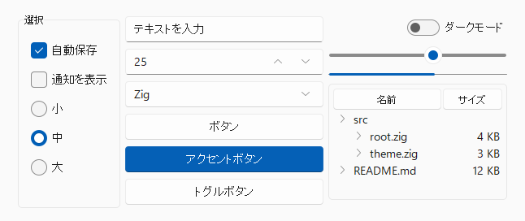
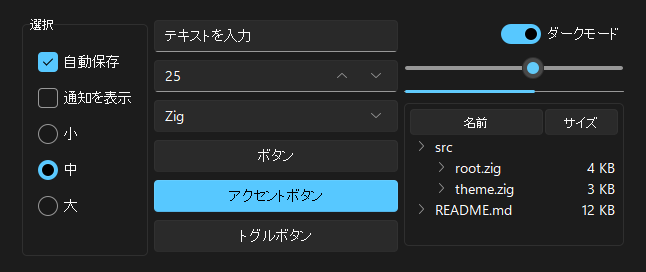
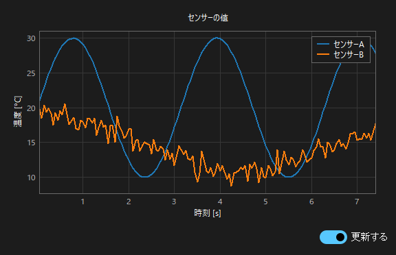
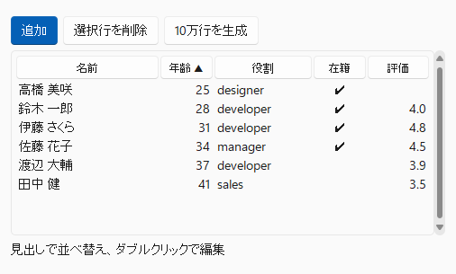

# zig_tk

Python の Tkinter に近い書き味で、Zig から Tcl/Tk の GUI を扱うライブラリです。

- **導入は1行**: `zig fetch --save git+https://github.com/okano-tomoyuki/zig_tk.git`。Tcl/Tk もソースから自動でビルドされ、別途インストールする必要はありません。
- **配布は実行ファイルだけ**: 静的リンク(依存のオプション `.linkage = .static`)なら、Tcl/Tk のランタイムごと 1 つの実行ファイルにまとまります。
- **今風の見た目も1行**: Windows 11 風のテーマ(明るい/暗い)を同梱しています。`try root.setTheme(.sun_valley_dark);`

| `.sun_valley_light` | `.sun_valley_dark` |
|---|---|
|  |  |

```zig
const std = @import("std");
const tk = @import("zig_tk");

pub fn main(init: std.process.Init) !void {
    const root = try tk.Tk.init(init.gpa);
    defer root.deinit();
    try root.title("Hello");

    const label = try tk.ttk.Label.init(root, .{ .text = "Hello, zig_tk!", .padding = .all(12) });
    try label.pack(.{});
    const quit = try tk.ttk.Button.init(root, .{ .text = "Quit", .command = tk.callback(&root, tk.Tk.quit) });
    try quit.pack(.{ .pady = 8 });

    root.mainloop();
}
```

## 特徴

- **型安全な名前付き引数**: Widget のオプションは構造体リテラルで渡します。オプション名の打ち間違い、値の型の誤り、存在しない列挙値はコンパイルエラーになります。
  ```zig
  try button.config(.{ .txt = "x" });      // error: no field named 'txt'
  try button.config(.{ .relief = .bumpy });  // error: enum 'Relief' has no member named 'bumpy'
  try frame.config(.{ .class = "X" });     // error: 生成時にしか指定できないオプション(classはinitでのみ指定可)
  ```
- **変数と値の型の対応**: `RadiobuttonOf(T)` / `CheckbuttonOf(T)` / `OptionMenuOf(T)` は、変数 `Variable(T)` と `value` / `onvalue` の型を揃えます。enum も使えます。
- **後始末が自動**: コールバック(`command` / `bind` / `after` / `validatecommand` など)は、Widget の破棄時(親の破棄による連鎖も含む)に解放されます。
- **Tcl/Tk を手元でビルド**: Tcl/Tk 9.0 のソースを `build.zig.zon` から取得してビルドします。ランタイムのスクリプトは zip として共有ライブラリ(または実行ファイル)の末尾に同梱されるため、配布時にスクリプトのフォルダは要りません。
- **Windows / Linux(X11) に対応**。

## 必要な環境

| | 必要なもの |
|---|---|
| 共通 | Zig 0.17.0 |
| Windows | 追加のツールは不要(MinGW ターゲットで Tcl/Tk をソースからビルドします) |
| Linux | C コンパイラ以外に X11 の開発用パッケージ。Ubuntu/Debian の場合:<br>`sudo apt install libx11-dev libxft-dev libfontconfig1-dev libxss-dev libxext-dev zlib1g-dev pkg-config` |

macOS は未対応です。

## 導入

`build.zig.zon` に依存として追加します。

```sh
zig fetch --save git+https://github.com/okano-tomoyuki/zig_tk.git
```

`build.zig`:

```zig
const std = @import("std");

pub fn build(b: *std.Build) void {
    const target = b.standardTargetOptions(.{});
    const optimize = b.standardOptimizeOption(.{});

    const zig_tk = b.dependency("zig_tk", .{ .target = target, .optimize = optimize });

    const exe = b.addExecutable(.{
        .name = "myapp",
        .root_module = b.createModule(.{
            .root_source_file = b.path("src/main.zig"),
            .target = target,
            .optimize = optimize,
            .imports = &.{.{ .name = "zig_tk", .module = zig_tk.module("zig_tk") }},
        }),
    });

    // 実行ファイルに加えて Tcl/Tk のランタイムを配置する(Linux では rpath も設定する)
    const app = @import("zig_tk").installApp(b, zig_tk, exe);
    app.run.addPassthruArgs();
    b.step("run", "Run the app").dependOn(&app.run.step);
}
```

`zig build run` は、インストール時と同じ配置にファイルをまとめてから起動します。リポジトリ内の [examples/consumer](examples/consumer/) が、この形の最小構成の例です。

### 依存のオプション

| オプション | 値 | 説明 |
|---|---|---|
| `.linkage` | `.dynamic`(既定) / `.static` | Tcl/Tk を共有ライブラリにするか、実行ファイルに静的リンクするか |
| `.@"tcl-source"` | `.vendored`(既定) / `.system` | `.system` はビルド済みの Tcl/Tk 8.6(MSYS2 等)の DLL をリンクします(開発用) |

### 配布物

| 構成 | インストールされるもの |
|---|---|
| 動的 / Windows | `bin/myapp.exe`、`bin/tcl90.dll`、`bin/tcl9tk90.dll` |
| 動的 / Linux | `bin/myapp`、`lib/libtcl9.0.so`、`lib/libtcl9tk9.0.so` |
| 静的 | `bin/myapp(.exe)` のみ |

Linux の実行時には、libX11、libXft、fontconfig、freetype、libXss、libXext、zlib が必要です(デスクトップ環境では通常入っています)。

## 使い方の要点

### Widget とオプション

```zig
const entry = try tk.ttk.Entry.init(frame, .{ .width = 30, .textvariable = name });
try entry.grid(.{ .row = 0, .column = 1, .sticky = .ew, .padx = 4 });
try frame.gridColumnconfigure(1, .{ .weight = 1 });
try entry.config(.{ .state = .disabled });
const width = try entry.cget(.width);   // cget の引数もオプション名の enum
```

- Widget は「インタプリタ + パス名」だけを持つ値で、自由にコピーできます。
- 第1引数は親 Widget です(Tkinter の暗黙の既定ルートはありません)。
- `pack` / `grid` / `place` / `bind` / `winfo` / `eventGenerate` などは、全 Widget 共通のメソッドです。

### コールバック

Zig にはクロージャがないため、「コンテキストのポインタ + 関数」で渡します。

```zig
const App = struct {
    count: u32 = 0,
    fn onClick(self: *App) !void { self.count += 1; }
    fn onKey(self: *App, e: tk.Event) !void { _ = e; _ = self; }
    fn digitsOnly(_: *App, v: tk.Validation) bool {
        for (v.change) |c| if (!std.ascii.isDigit(c)) return false;
        return true;
    }
};
var app: App = .{};
_ = try tk.Button.init(root, .{ .command = tk.callback(&app, App.onClick) });
try entry.bind("<Return>", tk.callback(&app, App.onKey));
_ = try tk.ttk.Entry.init(root, .{ .validate = .key, .validatecommand = tk.callback(&app, App.digitsOnly) });
_ = try root.after(1000, tk.callback(&app, App.onClick));
```

- 関数の引数の形で種類が決まります。`fn (ctx)` は command 用、`fn (ctx, tk.Event)` は bind 用、`fn (ctx, tk.Validation) bool` は入力検証用です。コンテキストが不要な場合は `tk.callbackFn(func)` を使います。
- コールバックがエラーを返した場合は、Tk のエラー報告(`bgerror`)に回されます。
- **ctx のポインタは、そのコールバックが呼ばれる可能性がある間、有効である必要があります**(通常は `mainloop` を呼ぶ関数のローカル変数で十分です)。

### 変数

```zig
const name = try tk.StringVar.init(root, .{ .value = "init" });
const Size = enum { small, medium, large };
const size = try tk.Variable(Size).init(root, .{ .value = .medium });
_ = try size.traceAdd(.write, tk.callback(&app, App.onSizeChanged));
_ = try tk.RadiobuttonOf(Size).init(frame, .{ .text = "Small", .variable = size, .value = .small });
```

### 戻り値の文字列の寿命

`get()` や `cget()` などが返す文字列は、**次に Tcl を呼び出すまで有効**です(Tcl の結果をそのまま参照しているため)。保持する場合は複製してください。一覧を返す関数(`Listbox.items`、`filedialog.askopenfilenames` など)は、アロケータを受け取って複製を返します(`tk.freeStrings` で解放します)。

### エラー

Tcl 側のエラーは `error.TclError` として返り、メッセージは `root.lastError()` で取得できます。ラップされていない Tcl コマンドは、`root.call(.{ "wm", "attributes", ".", "-topmost", true })` のように直接呼べます。

### テーマ

`root.setTheme(.sun_valley_light)` / `root.setTheme(.sun_valley_dark)` で、同梱の [Sun Valley](https://github.com/rdbende/Sun-Valley-ttk-theme) テーマに切り替わります。ttk の Widget に加えて、classic の Widget の配色も切り替わります。実行中に何度切り替えても構いません。

Sun Valley には独自のスタイルもあります。`style` オプションで指定します。

| スタイル | 対象 | 見た目 |
|---|---|---|
| `Accent.TButton` | `ttk.Button` | アクセントカラーのボタン |
| `Toggle.TButton` | `ttk.Checkbutton` | 押したままになるボタン |
| `Switch.TCheckbutton` | `ttk.Checkbutton` | スイッチ |

テーマのスクリプトと画像は実行ファイルに埋め込まれます(`setTheme` を使わないアプリには含まれません)。Tk 標準のテーマ(`clam`、`vista` など)は `ttk.Style.themeUse` で選べます。

### グラフ(Chart)

Canvas に折れ線・散布図を描きます。軸の範囲と目盛りはデータから自動で決まり、配色はテーマに合わせます。



```zig
const chart = try tk.Chart.init(gpa, root, .{ .title = "センサーの値", .x_label = "時刻 [s]", .y_label = "温度 [°C]" });
defer chart.deinit();
try chart.pack(.{ .fill = .both, .expand = true });

const a = try chart.addSeries(.{ .label = "センサーA", .max_points = 300 }); // 直近300点だけ保持
try chart.append(a, t, value);
```

- `append` / `setData` で点を変えると、イベントループが暇になった時に1回だけ描き直します(続けて追加しても描画は1回)。ウィンドウの大きさが変わった時も描き直します。
- 系列は `.kind = .line`(既定)/ `.scatter`。色を省くと既定の配色から順に選びます。
- `setXRange` / `setYRange` で軸の範囲を固定できます(`null` で自動に戻ります)。

### 表(Table)

構造体の配列を、そのまま表として表示・編集します。列は構造体のフィールドから作られます。



```zig
const Member = struct { name: []const u8, age: u32, role: Role, active: bool, rating: ?f64 = null };

const table = try tk.Table(Member).init(gpa, root, .{
    .editable = true,
    .columns = &.{ // 省略すると全フィールドを宣言順に表示
        .{ .field = .name, .heading = "名前" },
        .{ .field = .age, .heading = "年齢" },
        .{ .field = .rating, .heading = "評価", .decimals = 1, .editable = false },
    },
});
defer table.deinit();
try table.setRows(&members);
table.onEdit(&app, App.edited); // fn edited(self: *App, row: usize, field: tk.Table(Member).Field) !void
```

- 見出しのクリックで、その列の型に合った順序で並べ替えます(数値は数値順、enum は宣言順、`null` は先頭)。もう一度で逆順になります。
- `.editable = true` なら、セルのダブルクリックで編集できます。入力はフィールドの型に変換して戻し、変換できない入力は確定しません。enum は選択肢から選び、bool はダブルクリックで切り替えます。
- 使えるフィールドの型は `[]const u8`、整数、浮動小数点数、bool、enum と、それらの optional(空欄が `null`)です。
- 文字列のフィールドは表が複製して持ちます。`table.get(i)` / `table.items()` で現在の値を取得できます。
- **行数が多くても軽い**: 行は Zig 側に持ち、Treeview には見えている行の分だけ項目を置きます(仮想化)。20 万行でも `setRows` は約 6 ms、並べ替えは約 22 ms で、スクロールや削除は行数によらず一定です(ReleaseFast、描画の時間を除く)。
- 縦のスクロールバーは表に内蔵されています。選択(`select` / `selection` / `onSelect` / `removeSelected`)、上下キー・PageUp/PageDown・Home/End・Shift での範囲選択・Ctrl+A、ホイールでのスクロールも表が受け持ちます。

### スレッド

Widget・変数・`call` などは、`Tk.init` を呼んだスレッドからだけ使えます(Tcl のインタプリタは生成したスレッド以外から触れません)。Debug / ReleaseSafe ビルドでは、別のスレッドから使うと panic で止まります。

別のスレッドから画面を更新するには `post` を使います。`post` はどのスレッドから呼んでもよく、渡した値を複製して、Tk のスレッドのイベントループで関数を呼びます。

```zig
const Line = struct {
    text: tk.Text,
    buf: [64]u8,
    len: usize,

    fn append(self: Line) !void {
        try self.text.insert(.end, self.buf[0..self.len]);
    }
};

// ワーカースレッドの中で
try root.post(line, Line.append);
```

- 値にポインタやスライスを含める場合は、関数が実行されるまで指す先を有効にしておいてください。
- 関数が返したエラーは `bgerror` で報告されます。
- `deinit` の時点で未実行のものは捨てられます。`post` するスレッドは `deinit` より前に止めてください。

## 提供している機能

| 分類 | 内容 |
|---|---|
| classic Widget | Tk, Toplevel, Frame, LabelFrame, Label, Message, Button, Checkbutton, Radiobutton, Entry, Spinbox, Scale, Scrollbar, Listbox, Text, Canvas, Menu, Menubutton, OptionMenu, PanedWindow |
| ttk Widget | Frame, Labelframe, Label, Button, Checkbutton, Radiobutton, Entry, Spinbox, Combobox, Scale, Scrollbar, Progressbar, Separator, Notebook, Treeview, Panedwindow, Menubutton, Style |
| 変数 | StringVar, IntVar, DoubleVar, BooleanVar, `Variable(enum)`、trace |
| ダイアログ | `messagebox`, `filedialog`, `colorchooser` |
| 追加の部品 | `Chart`(折れ線・散布図)、`Table(Row)`(構造体の表示・並べ替え・編集)、同梱テーマ(`setTheme`) |
| その他 | `after` / `afterIdle` / `afterCancel`, `PhotoImage`, `font`, クリップボード, ウィンドウマネージャ操作(`title` / `geometry` / `protocol` / `iconphoto` …), スクロール連携(`scrollbar.attach(listbox, .y)`) |

## Tkinter との主な違い

- メソッド名は Zig の慣習に合わせて camelCase です(`pack_forget` → `packForget`、`trace_add` → `traceAdd`)。オプション名は Tk のままです(`borderwidth`、`textvariable`)。
- `Tk.init` には `deinit`、`PhotoImage` / `font.Font` / 変数には `deinit` があります。
- Tk 8.6 と 9.0 で既定値が違うものがあります。例えば Menu の `tearoff` は 8.6 では true、9.0 では false です。

## サンプル

| コマンド | 内容 |
|---|---|
| `zig build run-hello` | ボタンとラベル |
| `zig build run-form` | ttk の入力フォーム、StringVar の trace |
| `zig build run-dialogs` | `after` によるタイマーと標準ダイアログ |
| `zig build run-listbox` | Listbox と Scrollbar |
| `zig build run-editor` | Text、メニューバー、ポップアップメニュー、検索 |
| `zig build run-sketch` | Canvas でドラッグ描画 |
| `zig build run-explorer` | Notebook と Treeview |
| `zig build run-workers` | 複数のワーカースレッドから `post` で Text に追記 |
| `zig build run-themes` | 同梱テーマと、明るい/暗いの切り替え(`-- dark` で暗いテーマから起動) |
| `zig build run-chart` | 2つの系列をリアルタイムに流すグラフ |
| `zig build run-table` | 構造体の表の並べ替え・編集・追加・削除と、10万行の表示 |

## 開発

```sh
zig build test                        # テスト(Tcl/Tk 9.0 をソースからビルド)
zig build test -Dlinkage=static
zig build test -Dtcl-source=system    # MSYS2 等の Tcl/Tk 8.6 で実行
```

WSL2 上で Linux 向けに検証する場合は、Windows 側とキャッシュが衝突しないよう、キャッシュと出力先を分けます。

```sh
cd /mnt/c/path/to/zig_tk
zig build test --cache-dir ~/.cache/zt-cache --prefix ~/zt-out
```

## 既知の制限

- macOS は未対応です。
- Linux の動的リンク構成では、実行ファイルの RUNPATH にビルドキャッシュのパスが残ります(先頭は `$ORIGIN/../lib` なので動作には影響しません)。
- `Canvas.itemconfigure` と `Menu.entryconfigure` は、項目の種類が実行時にしか分からないため、オプションを `anytype` で受け取ります(名前の誤りは実行時に Tk が検出します)。
- `Interp.call` に直接渡したコールバックは、インタプリタを破棄するまで解放されません。
- Treeview の項目 ID(`Treeview.Item`)は最大47バイトです。
- Tk はスレッドセーフではないため、GUI の操作は `Tk.init` を呼んだスレッドから行ってください。

## ライセンス

zig_tk 本体は [MIT License](LICENSE) です。ビルド時に取得する Tcl/Tk は、それぞれの [license.terms](https://www.tcl-lang.org/software/tcltk/license.html)(BSD 系)に従います。

同梱テーマの [Sun Valley](https://github.com/rdbende/Sun-Valley-ttk-theme) は MIT License です。`setTheme` を使うアプリを配布する場合は、そのライセンス文面を配布物に含めてください。文面は `tk.theme.sun_valley_license` で取得できます。
